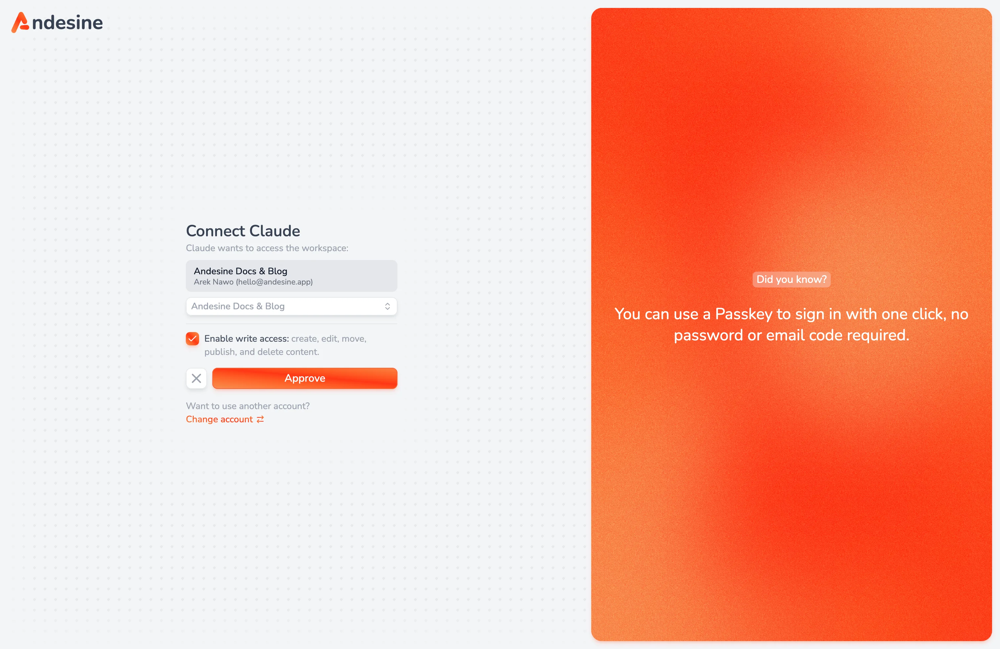

AI apps can use your workspace through the Andesine MCP server. They can search and read entries, write and edit them, manage versions and schemas, and publish, with your permissions. Changes that an AI app makes appear live for people who edit the same entry, and the app saves a version before its first edit of an entry.

The server address is:

```text
https://api.andesine.app/mcp
```

## How connecting works

1. You add the server address to your AI app.
2. The app opens Andesine in your browser. Sign in if necessary.
3. On the **Connect** page, choose the workspace that the app can use.
4. Select **Enable write access** if the app may create, edit, move, publish, and delete content. Without it, the app can only read.
5. Select **Approve**.



Each connection uses one workspace. To use another workspace, add the server again and choose that workspace. The app can do only what your role allows in that workspace.

Custom connectors can need a paid plan of the AI app. Check the documentation of your app.

## Set up your app

<Tabs syncKey="ai-app">
  <Tab label="Claude">
    In Claude, open **Customize → Connectors**, select **+ Add**, and select **Add custom connector**. Type `Andesine` as the name and `https://api.andesine.app/mcp` as the URL, then select **Continue**. Keep the sign-in settings and select **Add**. To use it in a chat, select **+**, then **Connectors**, and turn on Andesine. On Team and Enterprise plans, an owner adds the connector in **Organization settings → Connectors** first. Members then select **Connect**.
  </Tab>

  <Tab label="ChatGPT">
    In ChatGPT on the web, open **Plugins**, select **+**, and select **Add custom MCP server**. Type `Andesine` as the name and `https://api.andesine.app/mcp` as the **Server URL**, and select **OAuth** authentication. Select **I understand and want to continue**, then **Create as a plugin**. Your ChatGPT plan or workspace must allow custom MCP servers.
  </Tab>

  <Tab label="Cursor">
    Open this link to add the server to Cursor: [Add Andesine to Cursor](https://cursor.com/en/install-mcp?name=andesine\&config=eyJ1cmwiOiJodHRwczovL2FwaS5hbmRlc2luZS5hcHAvbWNwIn0%3D). Then select **Connect** next to the server in the MCP settings.
  </Tab>

  <Tab label="VS Code">
    Add the server to `.vscode/mcp.json` in your project, then select **Start** above the server:

    ```json
    {
      "servers": {
        "andesine": { "type": "http", "url": "https://api.andesine.app/mcp" }
      }
    }
    ```
  </Tab>

  <Tab label="Claude Code">
    Run this command, then run `/mcp` in Claude Code and select **Authenticate**:

    ```sh
    claude mcp add --transport http andesine https://api.andesine.app/mcp
    ```
  </Tab>

  <Tab label="Gemini CLI">
    Install the Andesine extension:

    ```sh
    gemini extensions install https://github.com/vriteio/andesine
    ```
  </Tab>

  <Tab label="Codex">
    Run:

    ```sh
    codex mcp add andesine --url https://api.andesine.app/mcp
    ```
  </Tab>
</Tabs>

## Connect a fixed workspace

To connect one workspace without the workspace picker, add its ID to the address:

```text
https://api.andesine.app/mcp/ws_...
```

Copy the workspace ID from the address of the app in your browser.

## Use an API key

Apps that can send headers can use an API key instead of signing in. Send a secret key as a Bearer token in the `Authorization` header. The app gets the key's workspace and permissions. Tools that the key's permissions do not allow are not listed. See [API overview](/docs/developers/api-overview/).

## Revoke access

Go to **Settings → Personal → Connected apps** and select **Revoke access** next to the app. The app loses access at once.

## Usage

Requests from AI apps count as API calls of the workspace. AI apps never use a seat. See [Plans and billing](/docs/workspace-administration/plans-and-billing/).

## Next steps

- To use Andesine from a coding agent with local files, see [Local server and plugin](/docs/ai-agents/local-server-and-plugin/).
- For the tools and prompts, see [Tools, resources, and prompts](/docs/ai-agents/tools-resources-and-prompts/).
