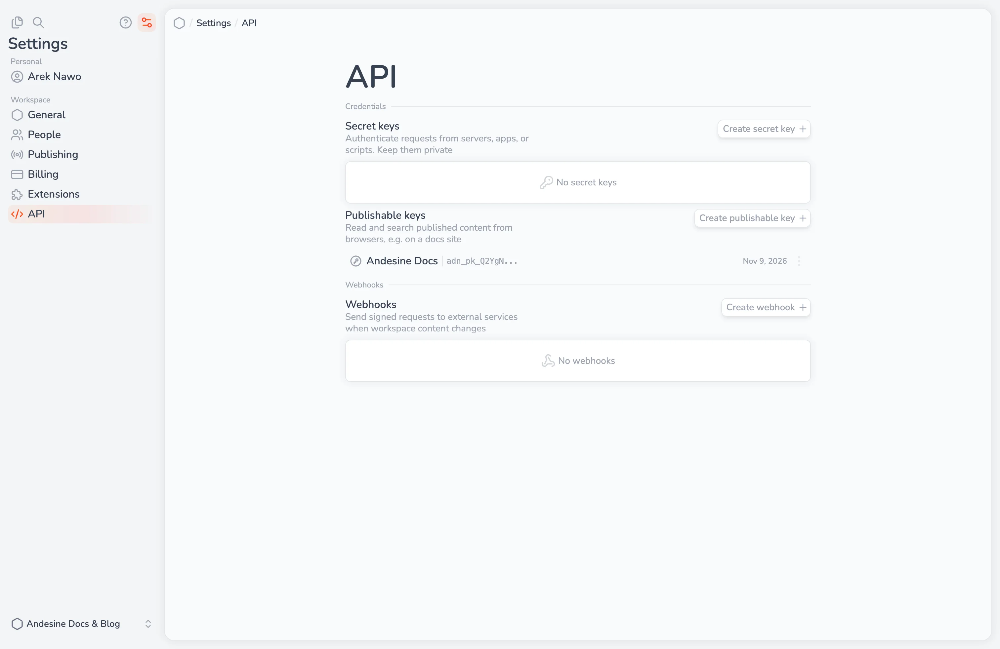

The Andesine API is an HTTP API with JSON requests and responses. Use it to read and change content, manage publishing, search, get AI answers, and manage webhooks. The base URL is:

```text
https://api.andesine.app
```

All operations, with their fields and examples, are in the [API reference](/docs/api/). In TypeScript, use the [SDK](/docs/developers/sdk/). From a terminal or a script, use the [CLI](/docs/developers/cli/).

## Authentication

Send a credential as a Bearer token:

```sh
curl https://api.andesine.app/... \
  -H "Authorization: Bearer $ANDESINE_API_KEY"
```

There are three kinds of credentials:

| Credential         | Format       | Use                                                                  |
| ------------------ | ------------ | -------------------------------------------------------------------- |
| Secret key         | `adn_...`    | Servers, scripts, and CI. Has the permissions that you choose.       |
| Publishable key    | `adn_pk_...` | Browsers and site builds. Reads and searches published content only. |
| OAuth access token | —            | Apps that act for a user, with the user's permissions.               |

Keys belong to one workspace. With an OAuth token, send the workspace ID in the `x-workspace-id` header.

## Create a key

Go to **Settings → API → Credentials**. You need a role with the **API keys** permission.

**Secret keys:** select the access to each area: **None**, **Read**, or **Write** for Collections, Entries, Versions, Publishing, People, Roles, and Webhooks, and whether the key can use **AI answers**. Give each key only the access that it needs. Keep secret keys on servers; never put them in browser code.

**Publishable keys:** select the **Collections** that the key can read, the **Allowed origins** of your sites, such as `https://docs.example.com`, and whether it can use **AI answers**. Browsers can use the key only on its origins. Requests without an `Origin` header, such as a site build on a server, are allowed. `localhost` is always allowed.

The key is shown once after you create it. Select **Copy key** and store it safely. To replace a key, select **Rotate key** and choose when the old key stops working: now, or after 1 hour, 24 hours, or 7 days.



## Current and published content

- **Current content** is what editors see. Read it with the entries and collections operations. This needs a secret key or OAuth.
- **Published content** is what is on a channel. Read it with the content operations, such as `content.getTree`, `content.get`, and `content.listEntries`, and the `channel` field, such as `published`.

Published reads return a `snapshotID`: the state of the channel at that moment. Pass it to later reads to get content from the same publish, also when someone publishes again in between. Snapshots expire after some time.

Content is returned as a JSON document. Set `contentFormat` to `mdx` to also get it as MDX. To convert the JSON to Markdown, HTML, or other formats, use the [converters](/docs/developers/converters/). Properties and fragments are returned by keys made from their names, such as `releaseDate` for **Release date**.

## Search and AI answers

- `search.published` and `search.current` search content. Set `semantic` to search by meaning; a semantic search uses 1 AI credit.
- `search.askPublished` and `search.askCurrent` answer a question from the content, with numbered sources. Each answer uses 10 AI credits. Stream answers with the `Stream` variants.

AI answers need a key with **AI answers** allowed. Questions can have up to 1,000 characters, and you can send up to 10 earlier messages as history.

## Limits

Rate limits count the requests of each credential in one-minute windows:

| Requests a minute | Free | Pro   |
| ----------------- | ---- | ----- |
| All requests      | 600  | 6,000 |
| AI answers        | 60   | 600   |
| Semantic search   | 300  | 3,000 |

Each workspace also has monthly API calls and AI credits. See [Plans and billing](/docs/workspace-administration/plans-and-billing/).

When a request reaches a limit, the API returns `429` with the code `TOO_MANY_REQUESTS`, a `Retry-After` header, and `data.limit`: `rate`, `api-calls`, `ai-credits`, or `spending`. Only `rate` limits pass within a minute; do not retry the others automatically.

Responses have headers with the current state of the limits:

- `X-RateLimit-Limit`, `X-RateLimit-Remaining`, and `X-RateLimit-Reset`.
- `X-API-Usage`, `X-API-Usage-Limit`, and `X-API-Usage-Reset`.
- `X-AI-Credits`, `X-AI-Credits-Limit`, and `X-AI-Credits-Reset`.

## Errors

Errors have an HTTP status and a JSON body with a `code`, a `message`, and a `data` object. `data.hints` often explains how to fix the request. Use the `code` in your code, not the message.

## Pagination

Lists return up to 50 items by default, and up to 100 with `limit`. Pass `pagination.nextCursor` as `cursor` to get the next page. A `null` cursor means the list is complete. For published lists, also pass the `snapshotID` of the first page.

## Safe retries

Creating and updating entries, and creating versions, accept an `Idempotency-Key` header. The API applies a key once and returns the first result for 24 hours, so a retried request does not apply a change twice.

Content reads return an `ETag`. Send it in `If-None-Match` to get `304 Not Modified` when the content has not changed.
