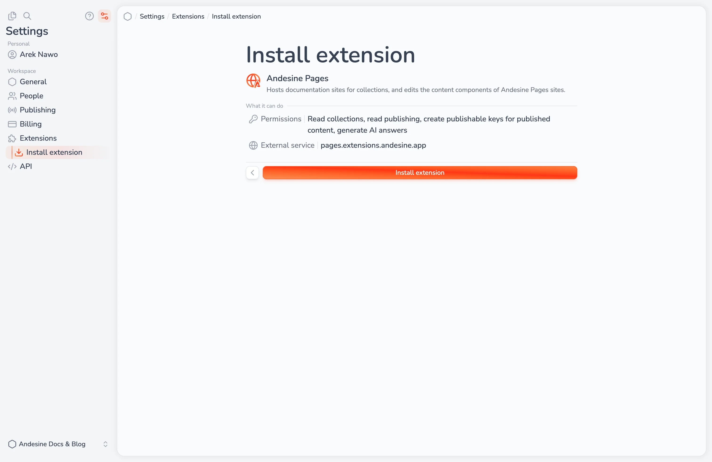

Extensions add features to a workspace. An extension can add:

- **Panels** next to the editor, such as the GitHub Sync status.
- **Pages** in the menu or in the menu of a collection or entry, such as the settings of a hosted site.
- **Element views** that show components in the editor as they look on your site.
- **Block actions** in the block menu of the editor.
- **Webhooks** and a backend service that work with your content.

Official extensions include [Andesine Pages](/docs/publishing/hosted-sites/) and [GitHub Sync](/docs/publishing/github-sync/).

## Install an extension

Go to **Settings → Extensions → Catalog**. You need a role with the **Extensions** permission.

1. Select an extension in **Available extensions**.
2. Read **What it can do**: the permissions that the extension asks for, such as reading collections or publishing. If it uses an outside service, **External service** shows its address.
3. Install the extension, and fill in its **Settings** if it has any.

An extension can do only what its permissions allow, and never more than the member who uses it. A workspace can have up to 20 extensions.

## Manage installed extensions

In **Settings → Extensions → Installed**:

- **Disable** turns an extension off and keeps its settings and data. **Enable** turns it on again.
- **Settings** changes its settings.
- **Uninstall** removes the extension and deletes its settings and stored data.

The details of an extension show its **Content views**, the element views that it adds, and its **Webhooks**. Select **Replace view** to use another extension's view for an element.

## Updates

Extensions update automatically. If an update asks for more permissions, a new external service, or new web addresses, Andesine disables the extension and shows **An update needs your approval**. A member with the **Extensions** permission, who has all the permissions that the extension asks for, selects **Allow and enable** to turn it on again. Updates that remove permissions apply at once.

If a version of an extension is withdrawn, for example because of a problem, Andesine moves the workspace to the newest version or to the replacement version, or disables the extension if there is neither.
