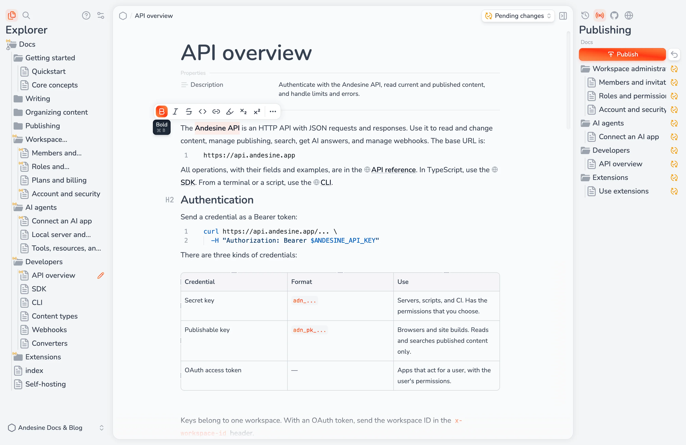

Andesine is a content workspace for docs, guides, and knowledge bases. Your team writes together in a real-time editor, gives content a structure with schemas, and publishes it to websites, apps, and AI agents.

## What you can do

- **Write together.** The block editor has Markdown shortcuts, tables, code blocks, images, and components. Changes appear live for all editors, and Andesine saves them as versions.
- **Organize content.** Collections hold entries in a tree. Schemas add typed properties and named content areas to the entries of a collection.
- **Publish with control.** You choose which version of each entry is public. Read published content with the API and the SDK, host a documentation site, or sync it to a GitHub repository.
- **Connect AI agents.** Claude, ChatGPT, Cursor, and other AI apps can search, read, and edit your workspace through MCP, with your permissions.
- **Extend the workspace.** Install extensions, or build your own panels, pages, and editor views.

## Andesine Cloud and self-hosting

Andesine is open source. Use Andesine Cloud at [andesine.app](https://andesine.app), or run Andesine on your own server with Docker.

## Next steps

<CardGrid>
  <Card href="/docs/getting-started/quickstart/" icon="i-lucide:rocket" title="Quickstart">
    Create a workspace, write an entry, and publish it.
  </Card>

  <Card href="/docs/getting-started/core-concepts/" icon="i-lucide:book-open" title="Core concepts">
    Learn how workspaces, collections, entries, and channels work together.
  </Card>

  <Card href="/docs/ai-agents/connect-an-ai-app/" icon="i-lucide:bot" title="Connect an AI app">
    Use Andesine from Claude, ChatGPT, Cursor, and other AI apps.
  </Card>

  <Card href="/docs/api/" icon="i-lucide:braces" title="API reference">
    Read and change content from your own code.
  </Card>
</CardGrid>
