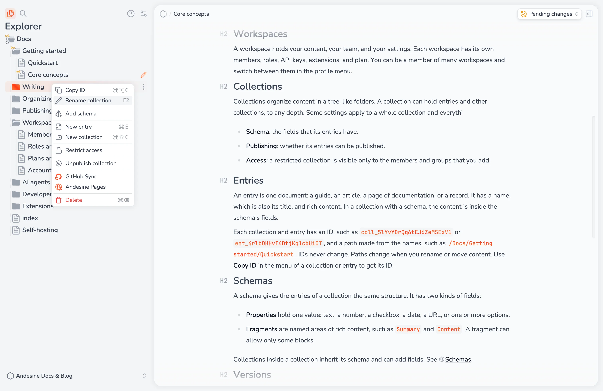

The explorer on the left shows the collections and entries of your workspace as a tree. Collections can hold entries and other collections, to any depth.

## Create

- Select **New entry** (⌘E) or **New collection** (⌘⇧C) at the top of the explorer.
- Open the menu of a collection and select **New entry** or **New collection** to create one inside it.

The name of an entry is also its title.

## Move and reorder

Drag collections and entries to a new position or into another collection. To move many items, select them first. Drag a box around them, ⌘-click or ⇧-click them, or use the keyboard. See [Keyboard shortcuts](/docs/writing/keyboard-shortcuts/).

If the new collection has a different schema, Andesine asks **Move and convert content?**. Select **Move & apply schema** to move the items and convert their content to the new schema. Content that does not fit the new schema is removed from the current content, but stays available in the entry's versions.

## Rename

Select **Rename entry** or **Rename collection** in the menu, or press F2.

## IDs and paths

Each collection and entry has an ID that never changes, such as `ent_4rlbOHHvI4DtjKq1cbUi0T`. Select **Copy ID** (⌘⌥C) in the menu to copy it. Use IDs in the API, the CLI, and integrations.

Each item also has a path made from its name and the names of its collections, such as `/Guides/Setup`, and a URL-friendly form of that path, such as `/guides/setup`. Paths change when you rename or move an item.

## Delete

Select **Delete** in the menu, or press ⌘⌫ or Delete. Deleting a collection also deletes everything in it. There is no trash.

If a deleted entry was published, it stays on its channels until you publish the change. The explorer shows it crossed out as **Pending removal**. To restore it, select **Revert pending changes**. See [Publishing and channels](/docs/publishing/publishing-and-channels/).

## Restrict access to a collection

Restricted collections need the Pro plan. By default, all members of the workspace can see all collections. A restricted collection, and everything in it, is visible only to:

- Members whose role has the **Restricted collections** permission.
- Members and groups that you add to the collection.

To restrict a collection, open its menu and select **Restrict access**. Then select **Manage access** to add people:

- **Member access** gives specific members a role in this collection.
- **Group access** gives all members of a group a role in this collection.

The role that you give applies only inside the collection. Select **Remove access** to remove a member or group, or **Derestrict access** to make the collection visible to all members again. See [Roles and permissions](/docs/workspace-administration/roles-and-permissions/).

## Collection settings

The menu of a collection also has:

- **Add schema**, **Edit schema**, and **Remove schema**. See [Schemas](/docs/organizing-content/schemas/).
- **Enable publishing** and the other publishing actions. See [Publishing and channels](/docs/publishing/publishing-and-channels/).
