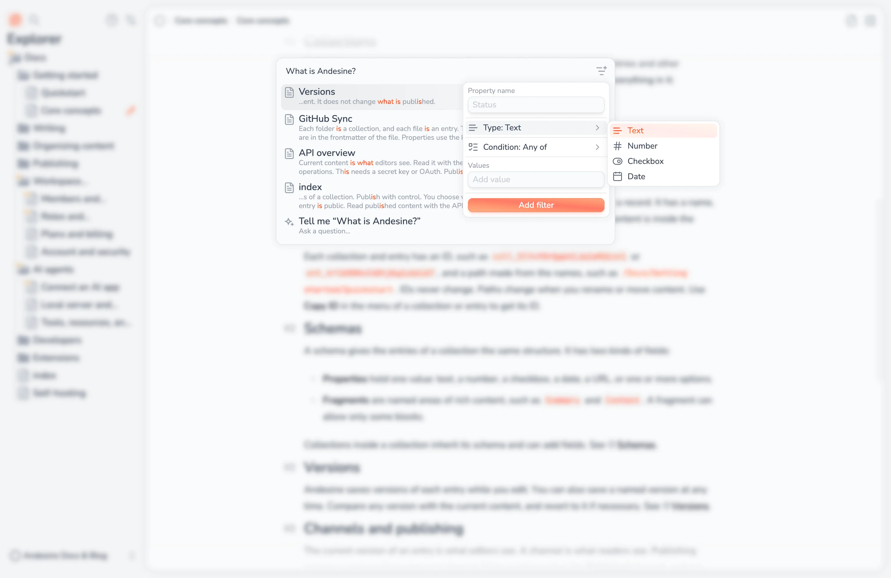

Press ⌘K or select **Search** in the menu to search your workspace or ask a question about it. Search shows only content that you can access.

## Search

Type a query to find entries by their title and content. Select a result to open the entry. Use the arrow keys and Enter to choose a result with the keyboard.

You must be online to search.

## Filter by properties

Select **Add property filter** to show only entries whose properties match. You can add up to 20 filters, and results must match all of them.

| Property type | Conditions                                                                                 |
| ------------- | ------------------------------------------------------------------------------------------ |
| Text          | Any of, All of, None of                                                                    |
| Number, Date  | Equals, Does not equal, Greater than, Greater than or equal, Less than, Less than or equal |
| Checkbox      | Checked, Not checked                                                                       |

Type the **Property name** as it shows in the schema. With filters and no query, the search lists all entries that match the filters.

## Ask AI

To ask a question, type it and select the last item, **Tell me "…"**. Andesine finds the relevant content and writes an answer while you wait. The **Answer sources** below the answer link to the entries that it used, so you can check the answer.

AI answers use only the content of your workspace that you can access. They can be wrong, so check important answers in the sources.

## AI credits

Ask AI uses AI credits from the workspace:

| Action                                                          | Credits |
| --------------------------------------------------------------- | ------- |
| An AI answer                                                    | 10      |
| A semantic search (API, or image search in **Choose existing**) | 1       |

The Free plan includes 5,000 credits each month. When they are used, Ask AI shows **No AI credits left** until the next month. The Pro plan includes 15,000 credits for each seat, shared by the whole workspace. More credits are billed as usage, up to the workspace's spending limit; at the limit, Ask AI shows **Spending limit reached**. See [Plans and billing](/docs/workspace-administration/plans-and-billing/).

AI answers and search on your sites and in your apps use the same credits. See [API overview](/docs/developers/api-overview/).
