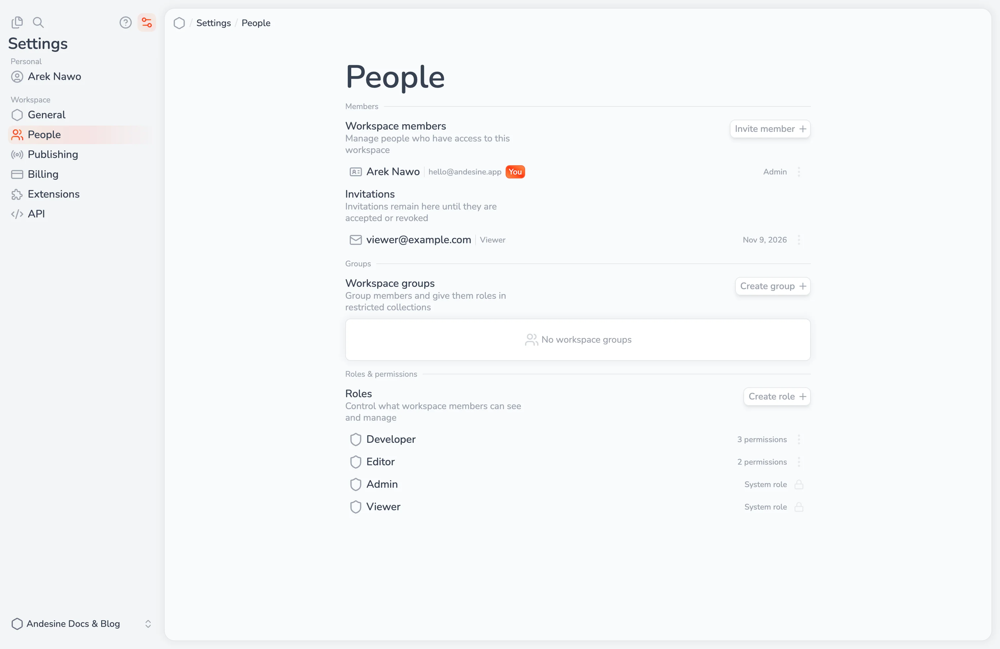

Go to **Settings → People** to manage who has access to the workspace. To invite or remove members, you need the **Manage** level of the **Members** permission.

## Invite a member

1. Select **Invite member**.
2. Type the **Email address** of the person.
3. Select the **Role** that they get when they accept. You can select only roles within your own permissions.
4. Send the invitation.

Andesine emails an invitation link. You can also select **Copy invite link** and send the link yourself. The person signs in or creates an account, and joins the workspace when they open the link.

The invitation must be accepted by the account with the invited email address. If it was sent to another address, the person sees **Sign in to the invited account**.

<Callout type="note">
  On the Free plan, a workspace can have up to 3 members, including pending invitations, and every member is an admin. The Pro plan has no member limit and supports all roles. See [Plans and billing](/docs/workspace-administration/plans-and-billing/).
</Callout>

## Manage invitations

Pending invitations stay in the **Invitations** list until they are accepted, revoked, or expired:

- **Resend invitation** sends the email again.
- **Copy invite link** copies the link.
- **Revoke invitation** stops the link from working.

An invitation expires after 7 days. Expired invitations are removed from the **Invitations** list. To send the invitation again, invite the person again. **Resend invitation** gives a pending invitation 7 more days.

## Change a role

Select **Set role** next to a member. The change applies at once. A workspace must always have at least one admin. See [Roles and permissions](/docs/workspace-administration/roles-and-permissions/).

## Remove a member

Select **Remove** next to a member. They lose access to the workspace at once. The content that they wrote stays in the workspace.

## Groups

Groups give many members the same role in [restricted collections](/docs/organizing-content/collections-and-entries/). Go to **Settings → People → Groups** and select **Create group**. Add members and pending invitations; invited people join the group when they accept.

Deleting a group removes its access to restricted collections. The members stay in the workspace.
