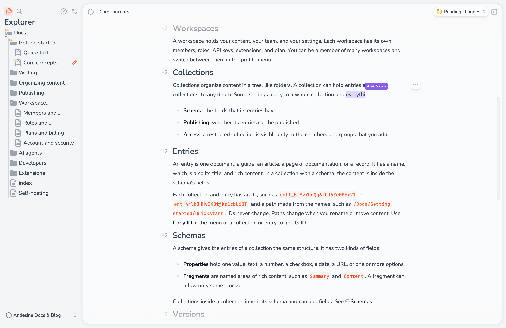

## Edit together

Many people can edit the same entry at the same time. You see the cursor of each editor, also in code blocks and table cells. Changes merge automatically, so there is no lock and no conflict to resolve.

When someone edits the tag of an element, other editors see that the tag is being edited until they finish.

Andesine saves versions of the entry while you edit, with the names of the people who contributed. See [Versions](/docs/organizing-content/versions/).

## Sync status

The editor shows the sync status of the open entry:

| Status                            | Meaning                                                                                                   |
| --------------------------------- | --------------------------------------------------------------------------------------------------------- |
| **Syncing**                       | Andesine is syncing the copy in this browser with the server.                                             |
| **Connecting**                    | Andesine is connecting to the server.                                                                     |
| **Offline, saved on this device** | You are offline. The entry is saved in this browser, and all changes are synced.                          |
| **Offline changes saved locally** | You have changes that are not synced yet. They are saved in this browser and sync when you connect again. |
| **Applying schema changes**       | A schema change is being applied to the entry.                                                            |
| **Sync failed**                   | Your changes are not saved on the server yet. Check your connection. Select **Retry**.                    |
| **Read-only**                     | You can read the entry but not edit it, for example as a Viewer.                                          |
| **Access lost**                   | You no longer have access to the entry, for example after a role change.                                  |

## Work offline

Andesine keeps a copy of your workspace content in the browser. When you lose the connection, you can still open entries you have opened before, and edit them. When you are online again, your changes sync and merge with the changes of other editors.

Some actions need a connection:

- Settings.
- Applying a schema.
- Uploading, inserting, or replacing images.
- Search and Ask AI.
- Publishing.

When you sign out, Andesine deletes the local copy from the browser.
