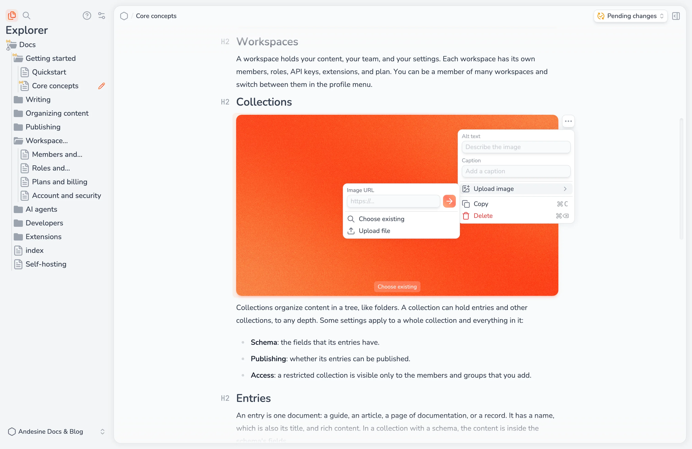

Images are stored in your workspace. You can use one image in many entries.

## Add an image

Select **Image** in the slash menu.

Select the empty image block and choose a file from your computer. Or select **Choose existing** to use an image that is already in the workspace. To use an address, open the block menu, select **Upload image**, and type a public `https` address in **Image URL**. Andesine copies the image into your workspace.

You can also drag an image file or an image URL into the editor, or paste an image.

If you upload an image that is already in the workspace, Andesine shows **Image already exists**. Select **Use existing image** to use the stored image, or **Upload anyway** to add a new copy.

## Find existing images

**Choose existing** searches the images by file name, by the text in the image, and by a description of the image. Andesine creates the description and reads the text automatically after each upload, so you can search for "pricing table" or for words in a screenshot.

Each search in **Choose existing** uses 1 AI credit.

## Alt text and captions

Open the block menu of an image:

- **Alt text** describes the image for screen readers and search engines. Write what the image shows.
- **Caption** shows text below the image.
- **Replace image** changes the image and keeps the alt text and caption. Upload a new file or choose an existing image.

## Supported files and limits

- Formats: JPEG, PNG, and static WebP.
- Maximum file size: 10 MiB for each image.
- Storage: 1 GiB for each workspace on the Free plan, and 50 GiB on the Pro plan.

An image that no entry uses is deleted 7 days after it was last used. Images in versions that you can still restore count as used.

You must be online to upload, insert, or replace images.
